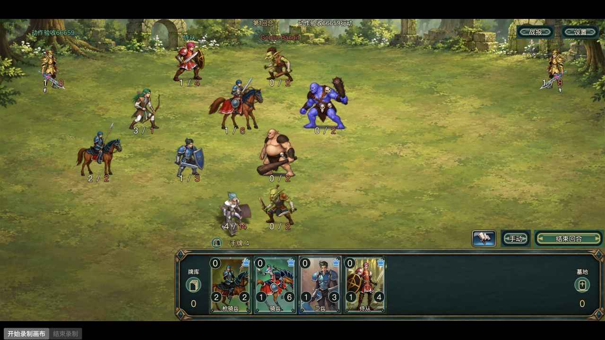

# 首章使用范围 · 第三批执行清单

2026-10-26。实施本地提交 `37774903c58d2891022ee0061a8af5bb2a284e4b`。本批以 `815caf0` / `3da020c` 为起点，在 `codex/art-samples-pve` 接入6个不同源模型；R2地图1、基础UI、卫兵和上批侍从/枪骑兵保留。只在本机执行，精简PVE范围、规则、卡池、经济和存档ID未改。用户最终视觉确认仍单独记录。

## 试玩与版本

- [当前批次](http://127.0.0.1:7440/?skin=sample)：v4；正式游戏入口，使用隔离库 `.local/art-samples/game.sqlite`。
- 对照：`?skin=sample-batch2` 为上批v3，`?skin=sample-r2` 为R2，`?skin=sample-v1` 为首批，`?skin=original` 为原资源。换皮肤前保存草稿，再切换URL；不回退数据库。
- 启动：在项目根运行 `./tools/art-samples/start-local.command`。本轮结束时7440服务保留运行；正常注册/建角即可体验，不需要GM。已有普通验收账号的浏览器标签保留。
- 原生构建：Cocos Creator 3.8.8 `web-desktop`。复用 `.local/art-batch-2/creator-build` 的已导入工程，编译前同步25个入口依赖，`stage-local.py` 逐字节核对；`evidence/release.json` 记录实施提交、源摘要、原生bundle和运行资源摘要。
- 设计1200×600；本次IAB视口/画布CSS为1280×720，画布像素2560×1440，DPR2。有效战场内容1280×640、上下各40像素留边，设计缩放1.0667。只验证本机此尺寸，不外推其他设备。

## 批次清单（制作前建立，现回填）

稳定模型ID、原名和动画名详见 [batch.json](../../../art-source/chapter1-batch3/batch.json)。卡牌ID先查怪物，再解析模型；没有按中文名或相似品质批量覆盖。

|对象|卡牌/怪物稳定ID → 动画名 → 模型ID|当前实际使用|复用与动作|本批结果|
|---|---|---|---|---|
|骑兵 Horseman|卡61→怪61；nanqibing01；model:084ab6a537029e5baa0a|第四张初始卡；普通103和105已部署|保留卡面；新制待机/骑行/剑盾攻击/受伤/倒地，左右脚底镜像|已接入；普通路径与混合场景均有证据|
|精灵猎人 Elven Hunter|卡5019→怪5019；lieren01；model:00fc2a2e0efd186fb8fa|101普通首通奖励；升级后进入5卡组，105部署|保留卡面；警戒/步行/拉弓释放/受伤/倒地，左右镜像|已接入；中文详情、保存和普通部署已检查|
|Goblin Bandit|怪60001（同模型基础卡3001）；dijingbubing01；model:8b1c69f6618c1d1f3f5f|101固定敌方英雄；基础卡同模型别名|保留对应卡面；木棍、低矮敏捷体态；五类动作和镜像|已接入；当前构建动作夹具实测，101普通通关沿用上批记录，未重打一遍|
|Goblin Maurader（原名拼写）|怪60002（同模型基础卡3019）；dijingdaozei01；model:8d96ae7e7cc6096e8d46|102固定敌方英雄|保留卡面；铜肩甲、双曲刃，独立双刀步态/攻击；五类动作和镜像|已接入；当前普通102出场、胜利并领奖|
|Ogre Destroyer|怪60003；jumomugun02；model:e20d7e5947f126a1af02|103固定敌方英雄|卡4008仅作身份参考，不自动覆盖该品质；蓝紫肌肉、刺棒；五类动作和镜像|已接入；当前普通103出场、胜利并领奖|
|Ogre Marauder|怪60005（同模型基础卡4001）；jumomugun01；model:d9297fe5cbede4982581|105固定敌方英雄|保留卡面；肉色大腹、粗木棒，与蓝紫巨魔轮廓不同；五类动作和镜像|已接入；当前普通105出场、胜利并领奖|

同模型别名只增加3001/3019/4001三个已核对完全相同模型的基础ID，没有覆盖其他装备、品质或技能变体。新骑兵使用原卡面的红马衣、青发、蓝银甲、剑盾，区别于上批长枪骑兵；精灵猎人保留绿发、轻甲、弓箭。没有重画卡图。

## 普通流程与动作夹具

**普通账号**沿用上批在真实Cocos注册/建角的隔离账号；本轮未给该账号发测试资产、改等级或解锁。101首通及精灵猎人奖励来源沿用上批记录，当前构建重新保存初始四卡 `[19,43,1,61]`，随后：

1. 102普通挑战，第4回合胜利，领取30银币、6经验及卡2，升到2级。
2. 查看精灵猎人中文详情，实际拖入卡组，保存为 `[19,43,1,61,5019]`，关闭重开显示5/5、已保存。
3. 103正常挑战，手动部署骑兵61，第4回合胜利；30银币、6经验、侍从卡19入库。
4. 105正常挑战，基础托管，第6回合胜利；最终存活单位包含初始四种和精灵猎人5019；领取30银币、6经验、哨卫卡8。
5. 当前银币420、金币20、晶石0，进度包含101/102/103/105；每场有且仅有一条结算记录。卡库滚动可见新奖励哨卫；临时移除骑兵形成草稿，跨栏拖回，滚动/固定中文详情未重置，最后撤销检查草稿恢复真实保存基线。

数据库只读核对见 [normal-growth.json](evidence/normal-growth.json)；截图：[初始四卡保存](evidence/normal-initial-deck-saved.png)、[102结算](evidence/normal-node102-result.png)、[骑兵部署](evidence/normal-horseman-deployed.png)、[103结算](evidence/normal-node103-result.png)、[105含精灵猎人结算](evidence/normal-node105-hunter-result.png)、[真实保存及中文详情](evidence/normal-five-card-saved-detail.png)、[卡库滚动及未保存草稿](evidence/normal-draft-scroll.png)。101与初始1/19/43的上批部署证据继续保留，未冒充本轮重验。

**动作夹具**仅补足九模型同屏、双向、近战/弓箭、移动、受伤和死亡。`create-animation-fixture.mjs --chapter-three` 在固定隔离库创建明确标记的零奖励战斗：10个初始兵种单位、2个英雄，之后自然抽牌/部署，峰值17个表现实体。保留原怪物数值和技能，由同一权威核心与事件队列执行，夹具只设初始布局；不是普通成长证明。补充使用 `--reverse-sides` 对12列战场镜像初始列并交换初始单位所有者，未改数值/规则，以真实Cocos检查相反方向的骑兵、弓手、两种哥布林和两种巨魔。见 [反向同场截图](evidence/mixed-reverse.png) 与 [40秒反向连续录像](evidence/reverse-actions.mp4)。

[48秒真实连续画布录像](evidence/mixed-actions.mp4)：从当前构建录制起点截取连续0—48秒，等速、无拼接，包含移动、近战/射击、受伤、三种新增敌人的倒地/淡出及第8回合零奖励结算。没有用姿态数量替代视觉判断。录像没有发现本批单位异常清空或死亡后孤立数值；不等于所有旧模型/设备/长时间运行已验收。

## 相邻排标注

`BattleSceneView.ts` 使用逻辑渲染位置和固定名称/攻血矩形判断冲突，不读每帧图片包围盒。相邻排名称挡住上一排攻血时默认隐藏名称，鼠标移入或点击单位后在本单位脚底上方38设计像素的固定安全带显示完整名称；独立84×90交互区避免170×170图像区域互相抢输入。攻血不缩小、不移动格子和部署热区。

上排右侧敌方名称同时避开原有战报/设置按钮。移动过程中保持局部文字位置，完成后按新站位重新判定；已有顶部HUD、按unitId统一死亡淡出和身份/代际保护保留，迟到资源回调还会核对当前display身份。

[悬停/点击展开骑兵名称](evidence/adjacent-name-revealed.png) 使用同一相邻排修正，拍于增加右上工具栏避让前；最终混合截图/录像已包含工具栏避让。没有把两者混写成同一构建截图。

## 图集引用与成本

旧“4图集”是**同时被引用的不同图集硬上限**，不是4个闲置缓存，也不是已发生故障的证据。本批将现有同一播放器的准入边界改为9个活跃图集、80MiB解码RGBA估算双限制；不是无限取消上限。

- 同URL/布局多个实例共享纹理和SpriteFrame，活跃引用绝不被淘汰。最后引用释放时直接释放帧、纹理和ImageAsset，不保留永久预载；正在加载且引用归零时中止所有权，迟到图片仅释放，不重新挂节点。
- 按规格先预留尺寸预算，实际图片到达后按真实尺寸再次校验。换帧继续使用已准备帧库；没有“先清空旧图再等下一张”流程。
- 六张新增运行PNG合计 **5,431,582字节（5.18MiB）**；新增基础RGBA **49.22MiB**，连同原三张共 **77.44MiB**。这是尺寸推算，不是测得显存；浏览器解码副本/驱动/GPU开销未单独测量。
- 真实混合初始9个活跃图集、9引用、275个SpriteFrame；后期5图集被12个实例共享，返回后图集/待载/引用/帧计数均为0。见 [同场](evidence/runtime-nine-models.json)、[结算](evidence/runtime-mixed-result.json)、[离场释放](evidence/runtime-released.json)。
- 本机rAF间隔P95采样约9.8ms，采样含静止等待，仅为本机代理指标，不是GPU内存、纯动作帧时或公网性能结论。新增观察器本身只在 `profile=1` 启用。
- 整段探针累计：首次未渲染139次；显式透明空样本166次；HP为0但无法由透明所有权确认的旧源空帧74次，**保留为歧义，不计作已证明合法死亡**；已渲染且有生命、非透明的意外空样本0次。计数是逐帧采样，不是139/166/74个故障或单位。旧源歧义仍需按具体模型另查，没有据此宣称全局零闪烁。
- 当前清单去重37个文件实际HTTP内容与本机SHA256一致，详情 [resource-check.json](evidence/resource-check.json)。未重新全量导出或审计原素材。

## 制作、定位和回退

[生成来源](../../../art-source/chapter1-batch3/generation.json)、[逐帧注册](../../../art-source/chapter1-batch3/registration.json)、[制作工具](../../../tools/art-samples/prepare-chapter1-batch3.py)。内置图像工具生成6个角色、共8次输出（两张巨魔额外修透明间距），原卡面/样板仅作身份和质感参考；原件只读，首版巨魔母图另存。最终五类动作均为独立绘制姿态，没有用单张图摇晃充数。

图集注册使用每列固定横轴、每行固定地面、一种兵种统一比例，不逐帧重心归中。巨魔不对称透明留白容纳木棒，与Sprite脚底锚点配对，逻辑脚底仍不变。骑兵320格/显示200，其余256格/显示170或190。攻击提示点：猎人0.375秒，其余本批0.25秒；与原模型语义一致，命中和扣血仍由既有事件队列驱动。左右为绕脚底镜像，不提供独立背面，装备会交换屏幕侧；没有修改箭矢、伤害或挂点规则。

涉及代码：`ArtSkin.ts`（v4及v3回退）、`SampleUnitAnimation.ts`（引用/预算）、`BattleSceneView.ts`（标注）、`observe.js`（诊断分类）；v4只引用原v2/v3地图/UI/三种单位，不复制维护播放器。原有滚动、详情和保存组件源码本轮未改。

定向回归：实际六种v4规格与三种v3共享、提示点、取消、9图集并发准入、80MiB和真实图片尺寸复核、晚到释放；当前展示方法的死亡/旧回调/文字安全区；既有权威表现队列顺序。均通过。这些引擎适配测试不替代上面的真实Cocos操作与录像；未运行全游戏测试。

## 未覆盖与继续边界（留在同一批次）

- 市政厅首领60007 / model:30945d8c76c9d4a31508为第7种，保留原资源；本轮普通账号尚未挑战107及后续章节。
- 当前敌方兼容手牌池跨种族，100种子抽样出现124个模型，不能把固定4个敌方英雄换图宣称整个首章随机敌军已统一。其他模型及其召唤物原样保留，没有静默过滤。未发现可据以保证固定首章召唤物覆盖的证据。
- 基础卡品质变体、随机奖励中卡2/8的独立模型、其他地图/主城/角色仍旧资源；未扩大为7032卡或全功能制作。
- 固定敌方英雄名称仍有既有英文/候选译名；本轮没有借美术任务重翻全库。生成帧细节、镜像装备方向和新旧材质最终协调仍由用户视觉评审，不标成已最终验收。
- 80MiB估算预算只覆盖当前9个图集；未来新增第10个同场模型应先重新评估，不能直接无上限增长。
- 原卡面参考来源的权利边界保留，生成派生不证明整款游戏完全原创或独立清权。个人存档、原素材、既有检查点及原未跟踪评审文件均保留。未连接或更新服务器、未推送或合并main。
