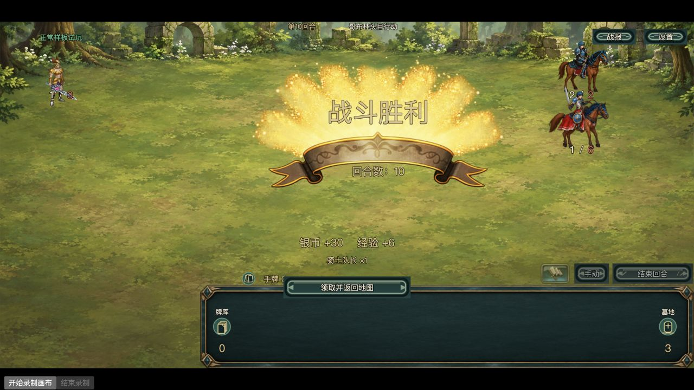
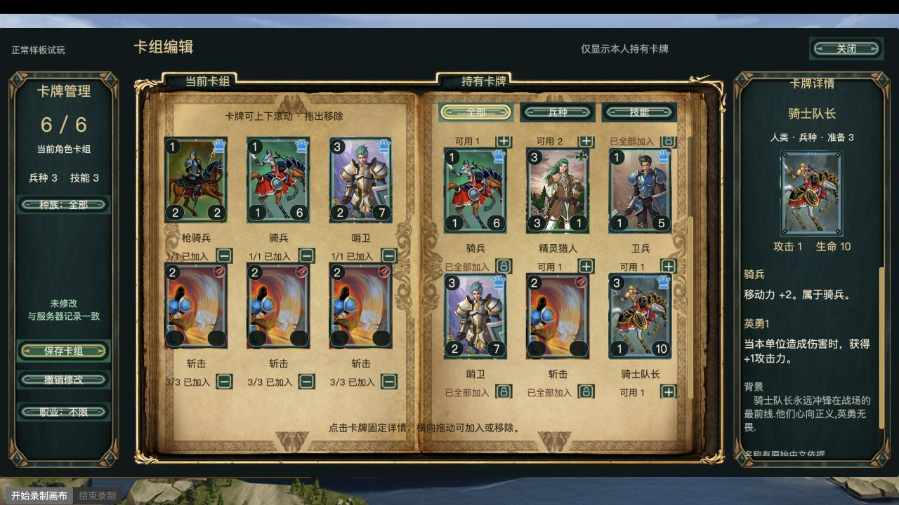
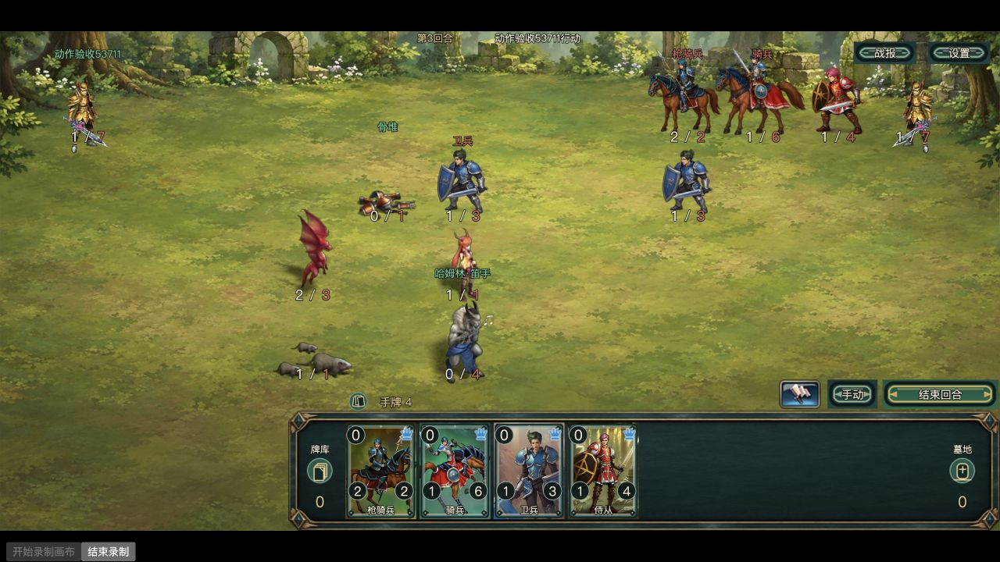

# 首章机制修订与普通107结果

2026-10-26。基线为 `24b58d6f90bb37444220686ddc288bb9d137db1b`，工作分支 `codex/art-samples-pve`。十九模型、R2背景、基础UI与精简PVE范围固定；本轮新增美术为0。未推送、合并main、连接或更新服务器，未写个人存档。实施与资料提交见上级 `commits.json.mechanics`。

## 本机入口

[继续普通账号试玩](http://127.0.0.1:7440/?skin=sample&client=batch2-normal)；[切换原资源](http://127.0.0.1:7440/?skin=original&client=batch2-normal)。切换前保存或撤销草稿，只换皮肤，不回退数据。当前普通账号已保留在浏览器，账号口令不进入交付资料。

```sh
./tools/art-samples/start-local.command
```

只监听127.0.0.1:7440；隔离库 `.local/art-samples/game.sqlite`。开发前一致性备份在 `.local/chapter1-mechanics/before-database/`，本地检查点在同目录 `checkpoint.json`。这些数据库与私密登录文件不纳入证据或Git提交。

## 修复与规则依据

| 机制 | 配置依据与原缺口 | 当前行为与实现分类 | 验证及边界 |
|---|---|---|---|
| 骷髅死亡形成骨堆 | Type85：1127→1169，1145→1187，1379→1380。旧通用邻格召唤丢失来源与死亡位置 | 在死亡原格建立配置指定骨堆，保留所有者、原卡及来源怪物。原卡由骨堆承接，最终被摧毁后只入墓一次。恢复配置关系，未按名称或种族猜目标 | 三组真实配置的内核用例；真实Cocos1127死亡→1169。地形即时死亡也通过既有死亡清理，夹具不改变普通资产 |
| 骨堆重组 | 1550→1513→2701/3301禁移禁攻；1550→8601无明确目标。旧实现按同种族首项变1001，仍不可行动 | 优先来源标记，否则由唯一Type85反向配置确认原骷髅；同一骨堆unitId、所有者与原格重建原单位属性和能力，清除骨堆内在禁移/死亡标记。外部状态继续沿既有规则生效 | 重组占用一次自身行动、下次正常行动，是**本版本时序约定**；不是已证实的原服服务器代码。三目标、再次死亡、JSON恢复、旧错误1001快照均有定向验证 |
| Blaze Adept首次召唤 | 12025→5027/Type50（一行动）→11701/Type117；旧静态展开有目标，回合执行却看不到子效果 | 活跃效果展开Type50的param2，独立持久行动时钟只执行一次；70/90/99/100累计阈值选择12001/12015/12032/12022。满合法相邻候选格时不生成、不补召、不覆盖单位 | 目标及权重沿配置恢复；相邻三候选格、失败不排队沿现有召唤规则作为**本版本边界**保留。真实Cocos一只龙、继续行动不再生成；服务重启与重复请求一致 |
| 7702击杀阻复活 | 描述明确禁止Reanimate、Soulbound、Skeleton；旧eraseKills未被击杀处理读取 | 实际致死者7702标记建立revivalBlocked，阻止Type32/41/85；普通入墓照常，其他死亡召唤不被误封，不赋予Type251无条件抹除 | 使用有真实触发对照的三个定向用例；未声称已审查7702涉及的全部伤害免疫组合 |
| Hamlyn the Piper鼠群 | 11043→6122/Type61→9038，原规则已生效 | 保持每次自身行动在既有合法邻格召唤；不在对手行动额外触发，不改卡池和数值 | 本项为确认而非新增。真实Cocos群鼠动画；重启后仅新增该次应有的一群，满格沿原合法性规则跳过 |

实现集中于 `BattleKernel.ts` 的 collectEffectRows/applyStaticEffects、handleKillEffects/removeDead、boneParent/processUnitTurn。客户端 `BattleSceneView.ts` 按同unitId检测模型变化，旧完整姿态保留到新模型准备好，再原子换入；释放旧显示宿主，晚到回调检查生命周期。骨堆名称和固定焦点区提示当前禁移、下次重组，重组时给出短反馈。顶部HUD、死亡统一淡出及固定标注坐标保留。

中文1550、5027在统一映射和生成来源文件同步改为 `version-implementation`；原文、稳定ID和原配置不变。说明不再把本版本时序冒充恢复的官方文案。旧存档不要求清空：已形成但错误变成1001的骨堆，仅在保留的骨堆配置身份明确时于后续自身行动修复；不会重写历史玩家资产或补造丢失来源。

## 普通107：真实胜利与推进边界

此前失败记录确认为5卡全入起手后疲劳竞速，部分保守AI单位远距离不移动；没有证据表明需要削弱敌人。详情及随机池追溯见 [107与池来源](107-and-pool.md)。

本轮在同一普通账号，通过正式职业技能商店以450银币购买三张斩击41001，真实保存六卡：`43 / 61 / 8 / 41001 / 41001 / 41001`。银币来自此前普通成长，没有GM发卡、改等级或数据库补资产。实际本轮只重试一局：玩家先手，枪骑兵与骑兵分别放第三、第四排己方前沿，斩击清除敌方生物，哨卫随后入场。第10回合获胜，实际领取30银币、6经验、骑士队长75×1；独立结算键只有一条。刷新及服务重新启动后首通标记、奖励卡和保存卡组仍在。





完整动作/奖励摘要为 [normal-107-result.json](evidence/normal-107-result.json)。这证明当前存在正常推进路径，不能外推所有种子必胜或托管胜率。首章101/102/103/105本轮复用当前基线的普通完成证据，没有重打全部节点。107后已显示完成及前往第二章；实际点击仍受等级5限制，当前3级/16经验，未进入第二章。普通PVE重复战斗和任务的经验路径保留，未为拍摄跳级或解除等级要求。第二章及之后不算本轮已通关。

## 连续录像、恢复与边界

[60秒真实Cocos连续录像](evidence/mechanisms.mp4)：从首次行动的火龙/群鼠召唤、骷髅死亡形成原格骨堆，到随后自身行动重组、再死亡。源录像94.60秒，交付保留前60秒原速连续段，没有拼接中段；约48—54秒可见重组回原骷髅。该片来自独立零奖励机制夹具，初始位置/所有者由夹具安排，数值与效果来自真实配置、通过正式权威战斗接口推进，不是普通获得证明。普通107截图/结果与夹具分开。



`recovery-and-retries.json`记录了真正停止并重新启动本机服务：回合5、revision8、61事件、1骨堆/2群鼠/1龙/1次重组的完整状态摘要一致恢复；继续一条合法请求到回合7，只增加应有的一次鼠群和一次重组，龙仍为1。完全相同请求重试回放原回执；同ID不同内容409 REQUEST_REUSE，新ID但过期角色版本409，草稿/资产无变化。浏览器在骨堆存在时刷新，按当前权威状态恢复，没有无条件回放全部历史事件。schema仍为2，无数据库结构变更或库替换。

## 图集与制作边界

[production-spec.md](../../../../art-source/chapter1-production/production-spec.md)已明确6×5、30姿态、默认fps是普通模板。现有清单每模型每动作可定义帧数、fps/时长、循环、cueFrame；十个v5新增对象3/8秒不推广为所有单位的命中点。专用残留物可显式收窄requiredStatuses；缺失动作不伪造步行/攻击。当前适配器支持既有规范动作与block，未宣称任意事件脚本。骨堆、群鼠和龙继续走恢复资源的原时间线，本轮没有生成额外专用素材。

十九图集/128MiB是当前sample资源包准入，不限制单位数或服务端合法动作。真实密集夹具由25个初始单位增长到30个显示，19图集/575共享SpriteFrame；活跃引用21→24，准备完成后待加载0，增加的骨堆/群鼠/龙使用恢复资源而非挤掉活跃新图集。离场后图集、引用、SpriteFrame和估算字节均为0。目录总量、活跃引用、零引用缓存和预加载分别记录：此银行零引用立即释放，不永久预载19种。没有实际触及第20张新图集，此情形不作验证承诺；未来新增专用新图集必须重新有限准入，不能以淘汰活跃纹理解决。

本轮图集下载/包体未增加，v5运行引用与上批一致：约15.24MiB下载，基础RGBA103,094,064字节（98.32MiB），后者不是整页内存或实测显存。画布显示1280×720、内部2560×1440，1200×600内容居中按1.0667缩放。运行采样见 [resource-lifecycle.json](evidence/resource-lifecycle.json)。密集阶段窗口P95帧间隔约8.8ms，含静止等待，不作压力基准。未分类意外空树采样0；初次未呈现和74次零血源空树分别保留，后者仍有歧义，不算已证明合法透明或普遍无闪烁。

## 验证范围与剩余事项

新骨堆/时钟/7702机制用例、受影响共享内核、残留物适配、显示生命周期、中文身份及实际Creator构建完成；命令和实际范围见 [checks.json](evidence/checks.json)。最后增加的焦点文字由生命周期用例核对，最终25入口源码重新构建并摘要一致；录像与密集场景取自同一规则和外观接入，仅早于这条焦点提示微调。未重跑整款游戏、所有卡牌、所有设备或公网测试。

- 首章119随机模型来自现行兼容共享候选池，不是已恢复的原始deckid遭遇牌组；129卡、有放回LCG抽4，固定敌人另算。本轮未改池、概率或奖励，也没有新增频率采样。
- 美术覆盖仍为直接12/12、随机/直接并集19/127；余108原模型及未穷举动态分支保留，不删除、不收池提高覆盖率。
- 第二章等级门槛、全设备视觉确认、7702其余伤害组合、未引用/暂缓召唤分支不在本轮完成结论中。
- 本轮无新增必须由用户决定的规则阻塞。旧资产兑换、退款、历史差额、账号支持及超级管理员指定仍为独立待决事项，没有执行。

本地代码接入与上述定向检查已完成；用户体验、原版完整复原和最终视觉确认仍分别记录。
