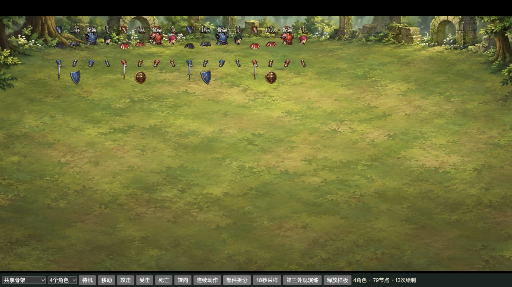
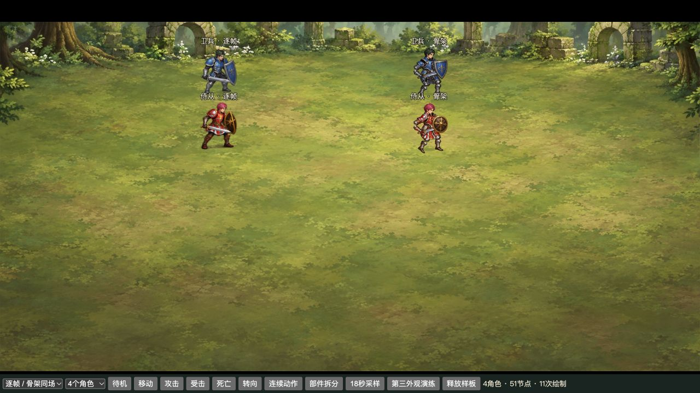

# 卫兵／侍从部件复用实验

2026-10-27；基线 `760c56e9a82c81bfc50af1880e7a3182d7424e66`，本地分支 `codex/rig-reuse-experiment`。**推荐 C：保留现有逐帧方案，未来合适的新角色再采用骨架。** 已做成原生 Cocos 可运行样板；没有迁移正式皮肤，没有调整规则、存档或其他17个角色。

共享部件把两种角色的纹理下载量从1,187,270字节降到143,014字节，基础RGBA从7.38MiB降到2MiB。但本次24角色场景的节点从123增至459、绘制从49增至73，P95帧间隔仍约17.7ms。动作的转身、武器透视与倒地轮廓也未达到现有逐帧水平。体积收益真实存在，当前综合收益不足以支持批量迁移。

## 本机运行与切换

- [同场样板](http://127.0.0.1:7462/?rigbench=1&mode=side&count=4)：左侧现有逐帧，右侧部件骨架。两侧使用同一动作时钟、同一显示比例、同一地图1和脚底坐标规则。
- 下方可选现有逐帧／合并图集／共享骨架，4／12／24角色，五类动作、转向、连续动作、部件拆分、释放。`18秒采样`是原生引擎测量；测量时不要同时录屏或构建。
- `第三外观演练`仅显示同骨架的侍从练习装，不绑定新卡牌或游戏ID。
- 当前隔离构建启动：项目根目录执行 `bash tools/art-samples/start-rig-experiment.command`。仅监听127.0.0.1:7462；数据在`.local/rig-experiment/data/`，未使用个人或此前美术测试数据库。
- 真实游戏接入使用 `?skin=sample&rig=shared&client=rig-fixture`；去掉`rig`恢复默认19种逐帧资源，`rig=packed`只验证两种角色的合并逐帧图集。实验开关仅localhost生效。
- 如需重建：`P0_BUILD_ROOT="$PWD/.local/rig-experiment/creator-build" P0_RECORD_BUILD_LOCATION=0 bash cocos-client/tools/build-p0.sh`，随后执行 `python3 tools/art-samples/stage-local.py --build-root .local/rig-experiment/creator-build --output .local/rig-experiment/web`。正式`.local/art-samples/web`不覆盖。
- 新建动作夹具可执行 `node tools/art-samples/create-animation-fixture.mjs --rig-experiment`，凭据只写本机私有`.local/rig-experiment/fixture-login.json`，不随交付或Git保存。夹具不证明正常成长可达，也不产生通关奖励。

## 部件拆分与共享边界

绑定沿当前v5映射核对：`main:monster:1`卫兵→`main:model:37d68956aa077843b62b`，`main:monster:19`侍从→`main:model:e1eec96444fbab197d3f`。实验只接这两个精确ID，不覆盖其他品质、相似名称或同族卡牌。

每种外观有16个独立完整部件：头、躯干、骨盆、裙甲／衣摆、双上臂、双前臂、双大腿、双小腿及靴、剑、盾、侧盾、低头替换头。其中14个槽同时绘制，侧盾与低头是局部姿态替换。源图是重新补绘的完整部件，**不是从旧整帧按矩形切下肢体**。

源稿及哈希在`art-source/rig-experiment/provenance.json`，完整补绘在该目录的`guard-parts-source.png`与`squire-parts-source.png`。源图4×4排列仅便于组织；打包时按连通透明轮廓取完整部件，边界只裁透明留白。登记见`registration.json`，可复跑`python3 tools/art-samples/build-rig-experiment.py`。

| 部位／机制 | 实际共享 | 需要独立的内容与限制 |
|---|---|---|
| 头、躯干、骨盆、衣摆 | 同一关节与槽位规格 | 卫兵蓝甲黑发；侍从红衣紫红发。两套像素不混用，补完整颈部、腰侧和盾后身体。肩甲与躯干仍有局部叠饰，未达到生产精修。 |
| 上臂、前臂、腿 | 关节位置、IK和动作曲线 | 重新补绘被盾与衣物遮住的上臂、肘膝连接和靴。衣甲材质分别绘制；骨架复用不等于四肢图片可直接共用。 |
| 武器与盾 | 握持点、屏幕层级、挂点变换 | 蓝鸢盾与圆盾分别绘制。侍从实验剑的曲度与原图有差异，不能作为正式替换。未增加任何兵种格挡能力：只有原清单存在block反应的卫兵接入格挡表现。 |
| 待机、移动、攻击、受击、死亡 | 两外观共用一套数学骨架和动作曲线 | 移动以实际位移推进步态，双腿独立IK；攻击有蓄势、挥动、回收，死亡有屈膝与分肢倒地。走路仍有轻微足底滑移，死亡末姿不如原逐帧自然。 |
| 特殊透视／遮挡 | 当前仅有低头、侧盾替换 | 肩部扭转、剑刃强透视、背身和侧卧尸体仍需要专门补绘或整帧插入。本次没有把14部件的平面旋转冒充这些姿态已经解决。 |

13关节层级在`SharedRigMotion.ts`：骨盆→躯干→头；躯干→双上臂→前臂→武器／盾；骨盆→双大腿→小腿。衣摆跟随骨盆。当前采用数学FK／双腿IK，最终以14个Cocos Sprite槽按固定遮挡顺序绘制；没有引入Spine、DragonBones或蒙皮网格框架。

两个角色共用动作函数，不维护两份外观专属轨道。左右使用脚底镜像，挂点同步镜像；它是同一三分之四视角的屏幕反向，不提供独立背视图。没有证据证明此骨架适合骑乘、四足、翼人、鼠群、灵体或骨堆。

## 动作与真实战斗

- [22秒连续五动作对照](evidence/same-scene.mp4)：原生Canvas原始录像截取连续22秒，无插画替帧或重排；待机→移动→攻击→受击→死亡。视频由2560×1440画布等比导出为1280×720。
- [真实战斗队列片段](evidence/real-battle.mp4)：专用隔离战斗，第1回合推进至第5回合；双方卫兵、侍从与原英雄、逐帧骑乘单位混用，保留非空横向手牌。此片段验证接入，不作为正常账号通关证据。
- 同一第5回合、相同HP／位置／手牌：[逐帧](evidence/real-battle-frames-same-turn.png)、[部件](evidence/real-battle-rig-same-turn.png)。切换只改变URL资源模式，没有回滚数据库。

沿用`RecoveredAnimation`播放句柄与`BattlePresentation`事件队列。卫兵／侍从原攻击cue均为3/12秒，即0.25秒，实验只把挥击接触安排在该时点，不改权威伤害。真实运行cue在0.25秒后的首个引擎更新触发，取消句柄不再发出旧cue。名称高度固定56设计单位，不依赖每帧包围盒；死亡仍由既有队列和宿主淡出处理。

`real-battle-observation.json`中观察到新部件8个活跃引用、32个共享SpriteFrame；未出现预热后意外空白。初始尚未呈现单独统计。该观察器会增加开销，其数据不用于下面的性能对比。

## 体积与运行成本

环境：Apple M5 Pro／48GiB／macOS26.6.2，Creator3.8.8，内置Chromium。设计1200×600；浏览器与CSS画布1280×720，SHOW_ALL设计缩放1.0667；DPR2，画布内部2560×1440。每模式一次18秒采样、剔除前0.8秒，24个卫兵／侍从实例；同背景、名字标签、位置、动作序列。采样时未开启录屏。桌面仍有普通应用，不是独占硬件基准。

| 指标 | 现有逐帧 | 无损合并逐帧 | 共享骨架 |
|---|---:|---:|---:|
| 输入源PNG（两角色） | 5,998,402B | 复用左列 | 2,830,048B |
| 活跃图集 | 2 | 1 | 1 |
| 纹理下载量 | 1,187,270B | 1,197,766B | 143,014B |
| 两角色资源ZIP，含精简清单 | 1,188,469B | 1,198,720B | 144,085B |
| 基础RGBA估算 | 7.38MiB | 7.67MiB | 2.00MiB |
| 原生场景总节点 | 123 | 123 | 459 |
| 实测每帧Draw Call中位数 | 49 | 49 | 73 |
| 动画更新CPU P95 | 0.10ms | 0.10ms | 0.70ms |
| 帧间隔P50／P95 | 16.7／17.6ms | 16.7／17.7ms | 16.7／17.7ms |
| 引擎纹理分配计数P95 | 13.86MiB | 14.14MiB | 8.48MiB |

资源ZIP只比较两角色的运行资源，**不是完整游戏安装包**。公共引擎、地图、UI在三组中相同，未重复计入。新增适配器与动作两个实际构建模块gzip约6,770B；诊断场景另约5,291B，不属于未来正式播放器必需成本。详见`comparison.json`，可执行`python3 tools/art-samples/compare-rig-experiment.py`复算白名单资源ZIP到`.local/rig-experiment/packages/`。

原图已经是无损WebP。合并逐帧逐像素校验65帧完全相同，但槽位补齐带来更大透明区域；名称Label仍打断角色之间的批次，所以合成一张纹理没有降低本场景Draw Call。共享骨架的14个槽在同图集中能批处理，但每角色另有接触阴影Graphics与名字标签，场景绘制反而增多。骨架变换也增加CPU工作。

73次绘制是当前适配层的结果，并非骨架的固有下限。将阴影纳入同图集、减少重复变换写入可能降低开销，但本轮没有实施或测量这些优化，不能把潜在收益计入结论。

RGBA是基础解码估算，引擎计数来自`device.memoryStatus.textureSize`，均不是驱动层实测显存。约60Hz上限下没有观察到整体帧率收益；0.1ms级CPU值受浏览器计时精度影响。不能从这一次18秒数据外推手机、长时间运行或全部兵种。

测量构建与最终构建摘要分别在`evidence/measurement-release.json`和`delivery-release.json`。后续仅补释放诊断、销毁检查和按原清单限制block反应，未改比较中的五态曲线、纹理、节点或采样算法；三组原始采样继续保留，没有把旧测量伪装成最终版本重新跑过。最终构建另有`final-build-sanity.json`。

## 生命周期与验证边界

同外观或不同外观实例共享同一Texture2D与32个SpriteFrame；首次异步加载也只请求一次图集。先登记引用，再等待加载；销毁等待者不能释放存活实例的纹理；最后引用归零释放，不永久预载。第三练习装为独立按需图集，不混入两角色体积或性能比较。

真实释放后`evidence/released.json`：角色0、场景节点3、骨架图集／引用0，逐帧图集／引用／帧0；引擎纹理计数回落到公共背景／标签等剩余资源。活动引用不受原19图集准入计数淘汰；本实验不提高原上限，也不把该额外实验图集准入为正式生产包。

定向检查完成：Creator原生构建与源码摘要一致、严格入口类型检查、`test-rig-experiment.mjs`的共享加载／晚回调／取消／cue／关节运动、现有`test-sample-unit-animation.mjs`的时钟与引用回归。Mock只证明对应逻辑；视觉与引擎指标来自真实Cocos。未重跑首章、全19模型、规则全量测试或公网验收。

## 一次性成本与第三外观边际成本

| 阶段 | 实际记录 | 适用边界 |
|---|---|---|
| 一次性：开始至两外观首次原生可见 | 18分57秒 | 含补绘生成等待、骨架／播放器／打包／比较场景编码与首次构建；不是纯人工绘画工时，也不代表达到生产质量。 |
| 第三外观：准备至生成／注册完成 | 59.15秒 | 同比例侍从练习装，完整新部件；图像工具等待43.766秒，复跑打包约0.57秒，其余为提示词与文件接入。 |
| 第三外观：准备至原生显示并操作五态 | 3分16.50秒 | 没有新增骨架或动作轨道；包含浏览器操作和工具等待。后续公共测量时钟修正不计为该外观专属制作。 |
| 第三外观运行增量 | 66,384B纹理／1MiB基础RGBA | 源稿约1.5MB；未绑定游戏ID，不算新增正式兵种。 |

时间戳保存在`art-source/rig-experiment/cost-log.json`。此轮没有重新制作第三种逐帧角色，不能据此声称其总工时一定更慢；两角色源PNG更小也不代表相同动作质量下的公平人工成本优势。

若迁移这两个既有角色，仍需分别修正轮廓与武器、补肩部转向／武器透视／侧卧姿态，再处理遮挡切换和步态接地；至少涉及**两套外观精修、三类特殊姿态、共同层级及步态调整**，具体姿态数量和工时尚未测量。其他人形有不同武器、比例或技能时也需要适配，不能按这次练习装的3分钟估算。骑乘、四足、飞行、残留物需要其他骨架或继续逐帧。

## 三选一结论与停止位置

- **A可作为现有方案的持续维护方向**：保留当前无损WebP、裁剪与按需释放。本次简单合并图集无收益，不直接替换v5。进一步压缩必须保持可读性并单独验证，不承诺凭合并即可加速。
- **B暂不采用**：同体型、同武器族、以换装为主的新角色可能适合共享骨架，但当前样板的动作质量与CPU／节点成本还不支持把全部人形迁过去。
- **推荐C**：保留19种正式资源与回退；实验作为未来新角色的可复用技术样板。是否投入上述精修并迁移批量流程，等待用户决定。

没有推送、合并main、连接服务器或修改个人存档。生成源稿与运行图集独立保存；来源记录不把生成衍生图宣称为原版资源或整款游戏原创。正式视觉验收仍单独保留。
