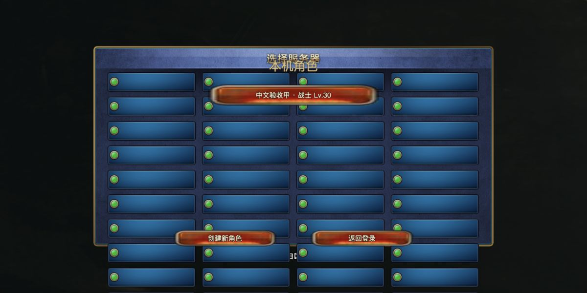
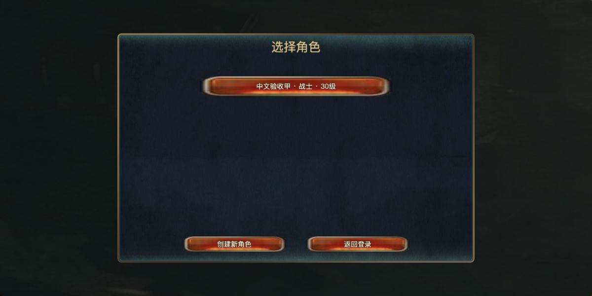

# A 修订版：地形玩法与主流程修正

2026-10-23，基于本机 `c64c085` 继续 `codex/stabilize-ui-chinese-server`。回退检查点为 `codex/checkpoint-before-terrain-20261023`。既有未跟踪评审资料、个人存档和原件保留，本轮测试仅使用临时库及 `.local/terrain-acceptance/game.sqlite`。规则本地提交为 `4e05cba`，界面与交付证据见随后提交（当前分支Git日志）；无远端写入。

13 张原先禁止施放的地形牌现已接入权威战斗、持久状态、正式 Cocos 地形标记和共享中文说明。角色选择的服务器模板重叠已移除；A 修订版双栏滚动、固定详情、拖放、真实保存及草稿保护继续保留。**本机定向验证完成，用户体验验收仍待进行；没有合并 main、推送或公网部署。**

## 隔离试玩与启动

[正式游戏入口](http://127.0.0.1:7425/?client=terrain-play)。交付浏览器页已登录测试账号，主角色有含孵化牌的合法10张卡组，可从主城继续 PVE。其他角色与第二账号仅用于隔离验收；凭据只留 `.local/terrain-acceptance/identity.json`（0600），不进入审阅包。

在项目根目录启动已构建的正式前端和同一服务端：

```sh
TIANXU_HOST=127.0.0.1 TIANXU_PORT=7425 TIANXU_DATABASE="$PWD/.local/terrain-acceptance/game.sqlite" TIANXU_LOG_DIR="$PWD/.local/terrain-acceptance/logs" node scripts/start-game.mjs
```

在对应终端按 Ctrl-C 正常停止。数据库路径必须指向隔离库。前端构建与运行分开；本机已有 `.local/web`，不需要重新下载客户端或导入全部资源。临时7426网关只用于录屏和故障注入，正式游戏不依赖它；旧7420基线服务本轮已停止。

## 本轮结果与证据

- [逐牌结果与说明](rule-descriptions.md)、[共享规则与补建边界](terrain-rules.md)：13张牌逐项绑定、数值、触发、范围、时限、覆盖和来源冲突。
- [服务验收](terrain-service-validation.md)：真实HTTP、合法卡组、非法操作、防重、冲突、重登录、服务重启、备份恢复和旧存档兼容。
- [验证记录](validation.md#2026-10-23-地形与主流程定向验收)：本轮真实Cocos、两个尺寸、保存、连续录屏与恢复边界。
- [角色选择与中文](selector-fix.md)：重复模板的根因、原件来源、开篇剧情和目标文案范围。
- [构建来源](terrain-build-source.json)、[运行状态证据](terrain-runtime-evidence.json)、[隔离移动事件](terrain-movement-evidence.json)。

| 功能可调用 | 流程可玩 | 界面与交互 | 战斗表现 |
|---|---|---|---|
| 13张牌真实执行，非空放或禁用 | 两个正式PVE分别使用孵化/岩浆，胜利及奖励返回 | 正式角色页去重；A版滚动、详情、拖放和保存复查 | 地形生效/移除按队列；进入伤害、死亡、孵化、逐格移动有真实片段 |

新地形格的色块、文字和剩余回合是本版本反馈组件，**不是原版地形动画恢复**。未修改角色模型、原始美术、战场相机或原战斗队列的动作时序。

## 截图与录屏

同一个旧测试账号、同一个角色状态、同为1200×600：

| 修正前 | 修正后 |
|---|---|
|  |  |

另有 [四角色状态](captures/terrain-selector-after-four-1200.png)、[1440×900角色页](captures/terrain-selector-after-1440.png)、[中文长说明与滚动](captures/terrain-deck-chinese-scroll-1200.png)。图片均为本项目真实Cocos截图，不冒充原版实机。

- [正式PVE：孵化施放→重复覆盖→召唤→到期](captures/terrain-hatch-live.mp4)，连续约54秒。
- [正式PVE：岩浆进入伤害→死亡→结算清理](captures/terrain-lava-hit-settle-live.mp4)。胜利最后由敌方英雄疲劳触发，没有把士兵地形伤害写成对英雄的伤害。
- [持续岩浆：隔离断网与服务停止/重启](captures/terrain-lava-recovery-live.mp4)。网络段为网关503故障注入，进程停止/重启真实执行；不代表公网弱网验收。
- [隔离移动场景：施放→卫兵移入→伤害→死亡](captures/terrain-movement-fixture-live.mp4)、[连续帧](captures/terrain-movement-continuous-frames.png)。该场景预置士兵和100点英雄生命，只用于补查表现；正式PVE证据是前两项。

## 中文与剩余缺口

13张牌从“本版本限制”改为有配置与实现依据的“本版本说明”；明确50809进入伤害采用效果参数5、50903对双方生物生效。规则不使用候选译名查表。开篇五个剧情节点、主要任务目标、错误和单位提示补中文，其他章节未冒充全剧情翻译。

沿用[中文覆盖清单](../ui-integration/chinese-coverage.json)：7032条展示映射、1852个不同原名；6919条名称记录仍为候选。750条技能说明中103恢复、633候选、14本版本说明。`unsupportedSkillCards`为空仅表示这份已登记清单的13个兜底已替换，不等于所有技能算法都已完整验收。

影响玩法的后续缺口：本轮13张以外的ServerClass18地形仍有旧即时增益路径，例如集结点41105/41107直接改攻击并写`terrainSkill`标记，尚未接入范围离开与期满撤销；部分原活动入口仍提示专属规则/窗口未恢复。这些未在本轮扩大修改，也不能写成全部完成。

不阻塞本轮玩法验证的展示项：少量主城宣传图英文、其他章节剧情及候选译名、原地形动画未接入。本轮未做原服算法运行对照、全章节回归、长期压力或公网设备验收。

## 历史稳定化成果

2026-10-22 的UI中文提交 `58caa7e` 与服务提交 `c64c085` 继续保留。既有事务、ActionOutbox、角色revision/卡组CAS、唯一结算、schema2、归档、备份恢复和部署准备见 [服务端变化](server-changes.md)、[部署准备](deployment.md)。旧969.3MiB运行包是上一轮快照，未重新打包为本轮产物；资源白名单已补入`TerrainRules.ts`，需要新独立包时应从当前源码重打包。
